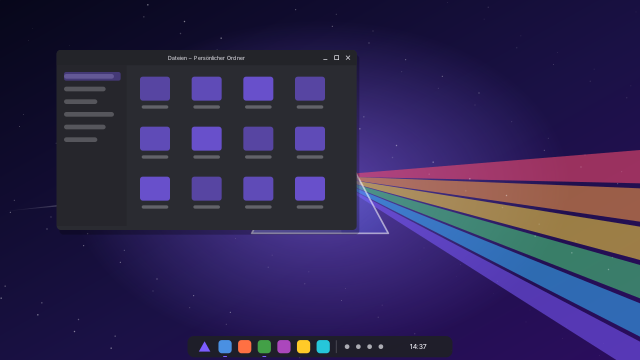

# PrismOS

**Dein System. Dein Look.** PrismOS ist ein schlankes, komplett personalisierbares
Betriebssystem auf Basis von Arch Linux und KDE Plasma. Vorinstalliert ist nur das
Nötigste. Alles andere wählst du bei der Installation selbst aus.



## Was PrismOS ausmacht

| | |
|---|---|
| **Jeder Look möglich** | Mit *Prism Looks* wechselst du per Klick zwischen den Vorlagen PrismOS, Windows 11, Windows 7, macOS, Ubuntu, GNOME, ChromeOS und Minimal. Du gestaltest eigene Looks, speicherst sie und teilst sie als `.prismlook`-Datei. Der Look lässt sich schon im Installer wählen. |
| **Keine Bloatware** | Vorinstalliert sind nur der Desktop, Dateimanager, Terminal, Texteditor, Archivprogramm, Screenshot-Werkzeug und das Software-Center. Alle weiteren Programme kreuzt du im Installer an, standardmäßig ist nichts ausgewählt. |
| **Programmauswahl im Installer** | Browser, Kommunikation, Office, Medien, Entwicklung, System-Werkzeuge und Design-Extras, aus den Arch-Paketquellen oder von Flathub. Sprachpakete (z. B. Firefox auf Deutsch) kommen automatisch dazu. |
| **Läuft auf jeder 64-Bit-Hardware** | BIOS und UEFI, Intel/AMD/NVIDIA-Grafik, Laptops und Desktops, virtuelle Maschinen. Der Installer erkennt NVIDIA-Karten (ab GTX 16xx/RTX) und virtuelle Maschinen und installiert die passenden Treiber. |
| **Akku & Leistung** | Zen-Kernel für flüssiges Arbeiten (LTS-Kernel als Notfall im Bootmenü), zram statt Swap-Datei, Energieprofile, Audio- und WLAN-Stromsparen, passende I/O-Scheduler, keine Hintergrund-Indizierung, kein Watchdog. |
| **Auf Deutsch** | Sprache, Tastatur und Zeitzone sind auf Deutsch voreingestellt und im Installer änderbar. |

## ISO herunterladen

Die ISO wird automatisch von GitHub Actions gebaut:

1. Öffne den Reiter **Actions** → **PrismOS-ISO bauen** und wähle den neuesten erfolgreichen Lauf.
2. Lade unten unter *Artifacts* die Datei **prismos-iso** herunter und entpacke das ZIP.
   Darin liegen `prismos-JJJJ.MM.TT-x86_64.iso` und die Prüfsumme.
3. Für eine dauerhafte Download-Seite: **Actions → PrismOS-ISO bauen → Run workflow**, dabei
   *Als GitHub-Release veröffentlichen* anhaken. Die ISO erscheint dann unter **Releases**.

Prüfen (optional): `sha256sum -c prismos-*.iso.sha256`

## Installieren

1. ISO auf einen USB-Stick schreiben (mindestens 4 GB), z. B. mit
   [Ventoy](https://www.ventoy.net), [balenaEtcher](https://etcher.balena.io) oder unter Linux mit
   `sudo dd if=prismos-….iso of=/dev/sdX bs=4M status=progress oflag=sync`.
2. Vom USB-Stick starten. Secure Boot muss im BIOS/UEFI ausgeschaltet sein.
3. Die Live-Sitzung startet und der Installer öffnet sich automatisch. Für die Programmauswahl
   am besten vorher über das Netzwerk-Symbol unten rechts mit dem Internet verbinden.
4. Durch den Installer klicken: Sprache → Zeitzone → Tastatur → Festplatte → **Programme** →
   **Look** → Benutzer → Zusammenfassung → Installieren.

Ohne Internet funktioniert die Installation auch. Die ausgewählten Programme werden dann
automatisch installiert, sobald der neue Computer zum ersten Mal online ist.

## Nach der Installation

* **Prism Looks** (im Startmenü) öffnet sich beim ersten Anmelden. Dort wählst du Vorlagen aus,
  gestaltest unter *Selbst gestalten* alles im Detail (Farben, Akzentfarbe, Fensterknöpfe,
  Symbole, Mauszeiger, Schriften, Leisten, Widgets, Kvantum-Themes, KDE Store) und speicherst das
  Ergebnis unter *Meine Looks*. Vor jedem Wechsel wird automatisch eine Sicherung angelegt.
* **Discover** installiert und aktualisiert Programme aus Arch Linux und Flathub.
* Im Terminal: `sudo pacman -Syu` aktualisiert das System, `prism-looks --apply macos` wechselt den Look.
* Bootmenü: Der erste Eintrag startet den Zen-Kernel. Falls nach einem Update etwas nicht läuft,
  wähle den Eintrag mit **linux-lts**.

## Aufbau des Projekts

```
iso/                      archiso-Profil
  packages.x86_64         Pakete der Grundinstallation (alles kommentiert)
  profiledef.sh           ISO-Einstellungen
  airootfs/               Dateien des Systems
    etc/calamares/        Installer: Ablauf, Programmliste (netinstall.yaml), Branding
    usr/lib/calamares/modules/prismapps/   eigenes Installer-Modul (Programme, Treiber, Look)
    usr/local/lib/prismos/                 Aufräumen nach dem Kopieren, Nachinstallation
    usr/share/prism-looks/                 Prism Looks (App + presets.json)
    usr/share/plasma/look-and-feel/        die Looks als Plasma-Global-Themes
packages/calamares/       PKGBUILD für den Installer (nicht in den Arch-Paketquellen)
scripts/build-iso.sh      baut die ISO (Arch Linux, root)
tools/generate.py         erzeugt Looks, Hintergründe, Logo und Installer-Grafiken aus presets.json
```

### Selbst bauen

Auf einem Arch-Linux-Rechner (oder im Container `archlinux:latest` mit `--privileged`):

```bash
sudo ./scripts/build-iso.sh out
```

### Eigene Vorlagen ergänzen

Einen Eintrag in `iso/airootfs/usr/share/prism-looks/presets.json` anlegen, das Leisten-Layout in
`tools/generate.py` (`LAYOUTS`, `WALLPAPERS`) beschreiben, dann:

```bash
pip install cairosvg pillow
python3 tools/generate.py
```

Programme der Installer-Liste stehen in `iso/airootfs/etc/calamares/netinstall.yaml`.
