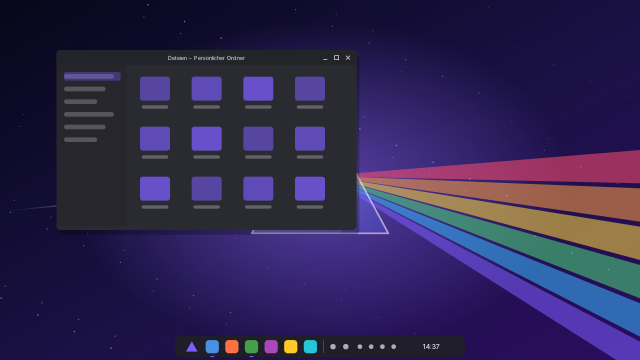

# PrismOS

**Dein System. Dein Look.** PrismOS ist ein schlankes, komplett personalisierbares
Betriebssystem auf Basis von Arch Linux und KDE Plasma. Vorinstalliert ist nur das
Nötigste. Alles andere wählst du bei der Installation selbst aus.



## Was PrismOS ausmacht

| | |
|---|---|
| **Jeder Look möglich** | Mit *Prism Looks* wechselst du per Klick zwischen 14 Vorlagen: PrismOS, Windows 11, 10, 7 und XP, macOS, Ubuntu, GNOME, Elementary, Deepin, ChromeOS, Holz, Nord und Minimal. Leisten und Docks passt du mit Schiebereglern an. Eigene Looks speicherst du und teilst sie als `.prismlook`-Datei. Lieblings-Looks markierst du mit einem Stern und wechselst mit **Meta+Umschalt+L** in einem kleinen Fenster schnell zwischen ihnen. Auf Wunsch wechselt das System automatisch zwischen hell und dunkel. Den Look wählst du schon im Installer. |
| **Keine Bloatware** | Vorinstalliert sind nur der Desktop, Dateimanager, Terminal, Texteditor, Archivprogramm, Screenshot-Werkzeug und das Software-Center. Alle weiteren Programme kreuzt du im Installer an, standardmäßig ist nichts ausgewählt. |
| **Programmauswahl im Installer** | Browser, Kommunikation, Office, Medien, Entwicklung, System-Werkzeuge und Design-Extras, aus den Arch-Paketquellen oder von Flathub. Sprachpakete (z. B. Firefox auf Deutsch) kommen automatisch dazu. Flatpaks installieren sich nach dem ersten Start im Hintergrund, eine Benachrichtigung meldet, wenn sie fertig sind. |
| **Läuft auf jeder 64-Bit-Hardware** | BIOS und UEFI. Unterstützt Intel-, AMD- und NVIDIA-Grafik, Laptops und Desktops sowie virtuelle Maschinen. NVIDIA-Karten (ab GTX 16xx/RTX) und virtuelle Maschinen werden erkannt, die passenden Treiber installiert. |
| **Akku & Leistung** | Zen-Kernel für flüssiges Arbeiten (LTS-Kernel als Notfall im Bootmenü). **Ladegrenze 80 %** (abschaltbar), im Akkubetrieb automatisch „Energiesparen“. Dazu zram statt Swap-Datei, Audio- und WLAN-Stromsparen, passende I/O-Scheduler, keine Hintergrund-Indizierung, kein Watchdog. |
| **Gaming-Modus** | Ein Controller-Knopf in der Leiste lädt die besten Einstellungen zum Spielen: volle Leistung, keine Benachrichtigungen und keine Hintergrund-Wartung, höchste Bildwiederholrate mit Adaptive Sync. Ein zweiter Klick stellt alles wieder her. |
| **Netzwerk auf einen Blick** | Ein Klick auf das Netzwerk-Symbol zeigt alle Verbindungsdaten: IP-Adressen, Gateway, DNS, MAC, WLAN-Signal, Kanal, aktuelle Datenrate. Auf Knopfdruck auch öffentliche IP mit Anbieter, Ping und Geschwindigkeitstest. |
| **Sicher zurück** | Btrfs mit **automatischen Snapshots** vor und nach jeder Installation und jedem Update. Den früheren Stand stellst du mit einem Klick wieder her. |
| **Verschlüsselung (freiwillig)** | Ein Häkchen im Installer. Entsperren lässt sich die Festplatte mit dem Passwort, zusätzlich mit einer **PIN** (TPM-Chip) oder einem **USB-Stick** als Schlüssel. |
| **Updates für PrismOS selbst** | Prism Looks, die Looks und die Systemeinstellungen kommen aus einer eigenen, **signierten Paketquelle** und aktualisieren sich mit `pacman -Syu` oder Discover. |
| **Auf Deutsch** | Sprache, Tastatur und Zeitzone sind auf Deutsch voreingestellt und im Installer änderbar. |

## ISO herunterladen

Die ISO wird automatisch von GitHub Actions gebaut und dabei getestet:

1. Öffne den Reiter **Actions** → **PrismOS-ISO bauen** und wähle den neuesten erfolgreichen Lauf.
2. Lade unten unter *Artifacts* die Datei **prismos-iso** herunter und entpacke das ZIP.
   Darin liegen `prismos-JJJJ.MM.TT-x86_64.iso` und die Prüfsumme.
3. Für eine dauerhafte und schnellere Download-Seite: **Actions → PrismOS-ISO bauen → Run workflow**,
   dabei *Als GitHub-Release veröffentlichen* anhaken. Die ISO erscheint dann unter **Releases**.

Prüfen (optional): `sha256sum -c prismos-*.iso.sha256`

Jeder Build startet die ISO in einer virtuellen Maschine (BIOS und UEFI). Außerdem spielt er
zwei Installationen nach und startet beide Ergebnisse: eine einfache mit BIOS und eine
verschlüsselte mit UEFI und Btrfs-Snapshots. Die Screenshots liegen im Artefakt
**boot-test-screenshots**.

## Installieren

1. ISO auf einen USB-Stick schreiben (mindestens 4 GB), z. B. mit
   [Ventoy](https://www.ventoy.net), [balenaEtcher](https://etcher.balena.io) oder unter Linux mit
   `sudo dd if=prismos-….iso of=/dev/sdX bs=4M status=progress oflag=sync`.
2. Im BIOS/UEFI **Secure Boot ausschalten** (PrismOS nutzt es nicht, es bleibt dauerhaft aus)
   und vom USB-Stick starten.
3. Die Live-Sitzung startet und der Installer öffnet sich automatisch. Für die Programmauswahl
   am besten vorher über das Netzwerk-Symbol unten rechts mit dem Internet verbinden.
4. Durch den Installer klicken: Sprache → Zeitzone → Tastatur → Festplatte (hier optional
   „Festplatte verschlüsseln“) → **Programme** → **Look** → Benutzer → Zusammenfassung → Installieren.

Ohne Internet funktioniert die Installation auch. Die ausgewählten Programme und der
LTS-Notfallkernel werden dann automatisch installiert, sobald der Computer online ist.

**Meldung „Verification failed: (0x1A) Security Violation“ beim Start?** Dann ist Secure Boot
eingeschaltet. Im BIOS/UEFI ausschalten, danach startet PrismOS normal.

## Nach der Installation

* **Prism Looks** (im Startmenü) öffnet sich beim ersten Anmelden.
  * **Vorlagen** wählst du per Klick.
  * **Selbst gestalten:** Farben, Akzentfarbe, Fensterknöpfe, Symbole, Schriften, Kvantum, KDE Store
  * **Leisten:** Position, Größe, schwebend, Dock
  * **Hell & Dunkel:** automatisch nach Uhrzeit oder Sonnenstand, standardmäßig aus
  * **Meine Looks** speichert dein Ergebnis. Vor jedem Wechsel wird automatisch eine Sicherung angelegt.
  * **Favoriten:** Stern ☆ an Vorlagen und eigenen Looks. **Meta+Umschalt+L** öffnet in der Bildschirmmitte
    die Auswahl (Pfeiltasten oder 1–9, Enter übernimmt). Die Tastenkombination änderst du unter
    Systemeinstellungen → Tastatur → Tastenkürzel → „Look wechseln“.
* **Prism Einstellungen** (im Startmenü):
  * **Akku:** Ladegrenze, automatisches Energieprofil
  * **Gaming:** was der Gaming-Modus umstellt (Leistung, Ruhe, Bildschirm), ein- und ausschalten
  * **Snapshots:** ansehen, erstellen, auf einen früheren Stand zurücksetzen
  * **Sicherheit:** PIN oder USB-Stick zum Entsperren einrichten, Passwort ändern
* **Discover** installiert und aktualisiert Programme aus Arch Linux, Flathub und PrismOS.
* Im Terminal: `sudo pacman -Syu` aktualisiert das System, `prism-looks --apply macos` wechselt den Look,
  `prism-gaming toggle` schaltet den Gaming-Modus, `prism-netinfo` zeigt die Netzwerkdaten als JSON.
* Bootmenü: Der erste Eintrag startet den Zen-Kernel. Falls nach einem Update etwas nicht läuft,
  wähle den Eintrag mit **LTS**.

## Aufbau des Projekts

```
packages/
  prismos-settings/       Systemeinstellungen, Akku, Snapshots, Verschlüsselung,
                          „Prism Einstellungen“ (files/ wird so installiert)
  prismos-looks/          Prism Looks, Look-Vorlagen, Farbschemata, Hintergründe
  calamares/              der Installer (nicht in den Arch-Paketquellen)
iso/                      archiso-Profil des Live-/Installationsmediums
  packages.x86_64         Pakete der Grundinstallation (alles kommentiert)
  airootfs/etc/calamares/ Installer: Ablauf, Programmliste (netinstall.yaml), Branding
  airootfs/usr/lib/calamares/modules/prismapps/   Installer-Modul (Programme, Treiber, Look)
  airootfs/usr/local/lib/prismos-live/            Aufräumen und Abschluss der Installation
scripts/build-iso.sh      baut Pakete und ISO (Arch Linux, root)
scripts/install-test.sh   spielt eine Installation nach (BIOS bzw. UEFI + Verschlüsselung)
scripts/boot-test.sh      startet ISO bzw. Installation in QEMU und macht Screenshots
tools/generate.py         erzeugt Looks, Farbschemata, Hintergründe und Grafiken aus presets.json
```

### Signierte Paketquelle einrichten (einmalig)

Damit installierte Systeme PrismOS-Updates bekommen, signiert die CI die Pakete mit einem
Schlüssel, den nur du besitzt. Unter Windows (PowerShell) richtest du ihn so ein:

```bash
winget install --id GnuPG.GnuPG
```

Danach ein neues Terminal öffnen:

```bash
gpg --batch --passphrase "" --quick-gen-key "PrismOS Paketquelle" ed25519 sign never
```

```bash
gpg --armor --output prismos-signing-key.asc --export-secret-keys "PrismOS Paketquelle"
```

```bash
Get-Content prismos-signing-key.asc -Raw | gh secret set PRISMOS_SIGNING_KEY -R AskForAngus/AI-created-OS
```

Bewahre `prismos-signing-key.asc` sicher auf, z. B. im Passwortmanager oder auf einem USB-Stick,
und lösche die Datei danach vom Rechner. Wer den Schlüssel hat, könnte Updates für alle
PrismOS-Rechner signieren.

Ab dann veröffentlicht jeder Build auf `main` die Pakete im Release **repo**. ISOs vom `main`-Zweig
tragen die Paketquelle automatisch ein.

### Selbst bauen

Auf einem Arch-Linux-Rechner (oder im Container `archlinux:latest` mit `--privileged`):

```bash
sudo ./scripts/build-iso.sh out
```

### Eigene Vorlagen ergänzen

Einen Eintrag in `packages/prismos-looks/files/usr/share/prism-looks/presets.json` anlegen,
Leisten-Layout und Hintergrund in `tools/generate.py` (`LAYOUTS`, `WALLPAPERS`, bei Bedarf
`COLOR_SCHEMES`) beschreiben, dann:

```bash
pip install cairosvg pillow
```

```bash
python3 tools/generate.py
```

Programme der Installer-Liste stehen in `iso/airootfs/etc/calamares/netinstall.yaml`.
